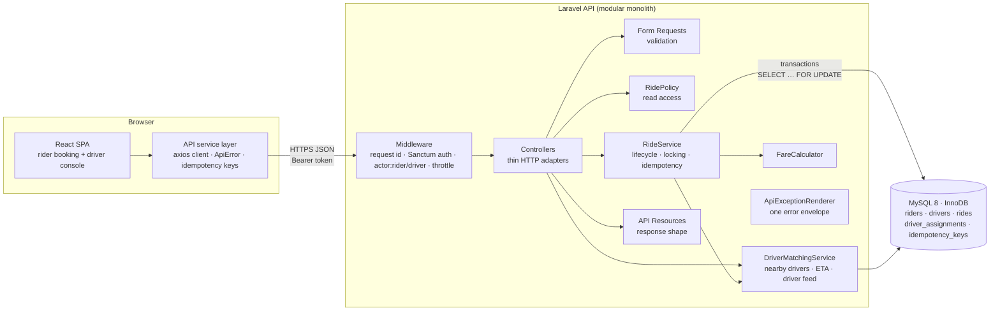
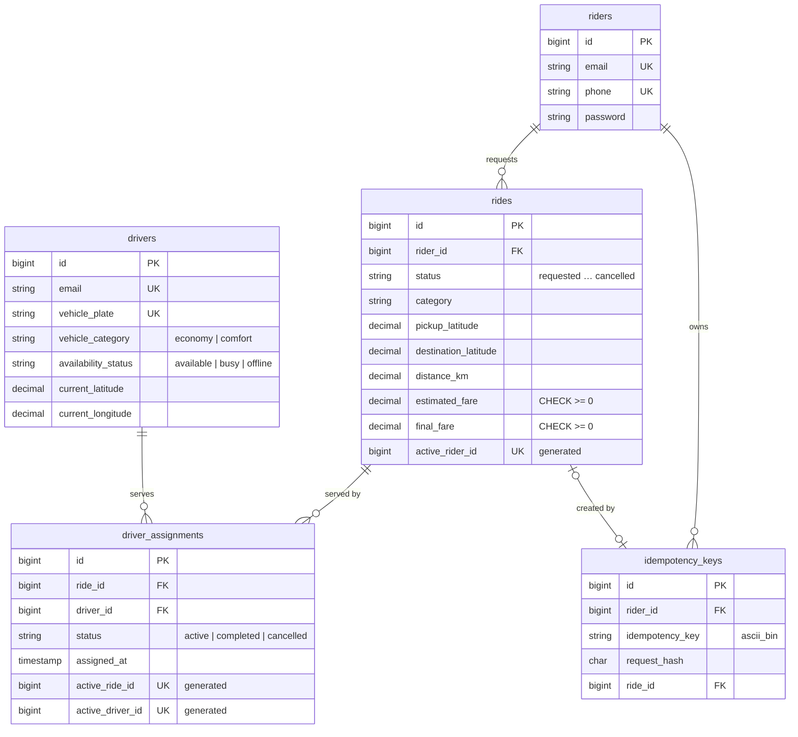
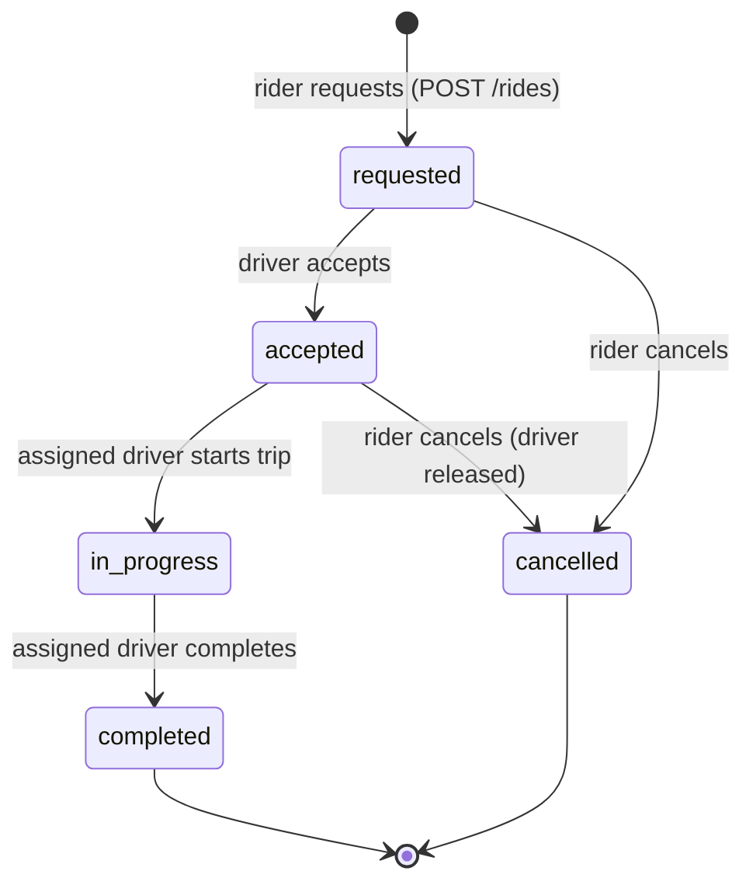

# Architecture & Design Notes

Sawari is a simplified ride-booking platform for Lahore. A rider requests an Economy or Comfort ride; nearby eligible drivers see the request; exactly one driver can accept it; the ride then moves through a strict lifecycle until it is completed or cancelled.

This document answers the assessment's architecture questions and records the main design decisions and trade-offs.

---

## 1. Technology stack and why

| Layer | Choice | Why |
|---|---|---|
| API | **Laravel 12 (PHP 8.2+)** | Mature, batteries-included framework: routing, validation (Form Requests), API Resources, Sanctum token auth, migrations, queues and scheduler. One framework covers everything this feature needs, so time goes into domain logic instead of plumbing. |
| Database | **MySQL 8 (InnoDB)** | Transactions with row-level locking (`SELECT … FOR UPDATE`), unique indexes on generated columns and enforced `CHECK` constraints. These are exactly the tools needed to make driver assignment race-free. |
| Auth | **Laravel Sanctum** personal access tokens | Simple bearer tokens, polymorphic over two separate account tables (`riders`, `drivers`). No OAuth server needed. |
| Frontend | **React 19 + TypeScript + Vite + Tailwind 4** | Typed API contracts, fast tooling, utility CSS for a consistent responsive UI without a component library. |
| Tests | **PHPUnit** (against real MySQL), **Vitest + Testing Library**, **Playwright** | Business rules and concurrency are tested against the real database engine; UI states are tested in isolation; one browser E2E test covers the whole flow. |

### Why a modular monolith and not services

This is one bounded context (ride booking) owned by one team. Microservices would add network failure modes, distributed transactions and deployment overhead, and would make the hardest requirement (exactly one driver per ride) *harder*. Inside one database it is a single local transaction. The code is still split into clear layers, so pieces can be extracted later if scale demands it (see §6).

### Why MySQL and not Redis or a queue for matching

The correctness guarantee ("one driver per ride, one ride per driver") belongs in the system of record. Doing it in MySQL means the guarantee survives process crashes, retries and restarts, and is backed by schema constraints. Redis locks or queues would be a second source of truth to keep consistent.

---

## 2. Application architecture



### Folder structure

```
backend/
  app/
    Data/RideRequestData.php          validated input DTO + request fingerprint
    Enums/                            RideStatus (state machine), RideCategory, DriverAvailability, AssignmentStatus
    Exceptions/                       ApiException, InvalidRideTransitionException, ApiExceptionRenderer
    Http/Controllers/Api/             Auth, Ride, Driver, FareEstimate, Meta (health, locations)
    Http/Middleware/                  AssignRequestId, EnsureActorType
    Http/Requests/                    Form Requests (validation only)
    Http/Resources/                   API Resources (response shape only)
    Models/                           Eloquent models (relations, casts; no business logic)
    Policies/RidePolicy.php           who may view a ride
    Services/                         RideService, DriverMatchingService, FareCalculator
    Support/GeoPoint.php              Haversine distance + bounding box
  config/rides.php                    pricing, matching radius, service area, place catalogue
  database/migrations | seeders | factories
  public/openapi.yaml                 API contract (Swagger UI at /docs)
  tests/Unit | Feature | Concurrency  (Concurrency uses real OS processes)

frontend/src/
  api/          client.ts (axios + ApiError), services.ts (typed endpoints), types.ts
  auth/         AuthProvider + useAuth
  hooks/        usePolling
  components/   rider/ (BookingForm, RideStatusCard, RiderHome), driver/, ui.tsx, MapPlaceholder
  e2e/          Playwright browser test (frontend/e2e)
```

**Rule of thumb:** controllers translate HTTP to service calls; services own every business rule and transaction; models describe data; resources describe responses.

---

## 3. Database schema



### Integrity enforced by the database itself

| Rule | Mechanism |
|---|---|
| A ride has at most one active driver | `active_ride_id = CASE WHEN status='active' THEN ride_id END` (STORED) + `UNIQUE` |
| A driver has at most one active ride | `active_driver_id` generated column + `UNIQUE` |
| A rider has at most one active ride | `rides.active_rider_id` generated column + `UNIQUE` |
| Fares and distances are never negative | `CHECK (estimated_fare >= 0)` etc. Money is `DECIMAL(10,2)` |
| Only valid enum values | `CHECK (status IN (…))` on every status and category column |
| Idempotency keys are unique per rider | `UNIQUE (rider_id, idempotency_key)`, case-sensitive `ascii_bin` collation |
| Referential integrity | Foreign keys with `RESTRICT`: history is never silently deleted |

MySQL has no partial unique indexes, so a nullable generated column that is `NULL` for finished rows emulates `UNIQUE … WHERE status = 'active'`. Completed and cancelled assignments are kept as history. A separate `driver_assignments` table (instead of `rides.driver_id`) keeps that history and leaves room for reassignment if a driver later drops a ride.

Indexes support the hot queries: `(availability_status, vehicle_category)` for matching, `(status, category, requested_at)` for the driver feed, and `(rider_id, created_at)` for ride history.

---

## 4. Ride lifecycle



The allowed transitions live in one place: `App\Enums\RideStatus::allowedTransitions()`. `RideService::transition()` is the only code that changes a ride's status, and it throws `InvalidRideTransitionException` (HTTP 409 `INVALID_RIDE_TRANSITION`, including `allowed_transitions` in `details`) for anything else. Examples: a completed ride cannot be cancelled, a cancelled ride cannot be accepted, and a ride cannot be completed before it has started.

Actor rules are checked **inside the locked transaction**, where they cannot race:

- only the owning rider can cancel (`403 NOT_RIDE_OWNER`)
- only the assigned driver can start or complete (`403 NOT_ASSIGNED_DRIVER`)
- the driver's identity always comes from the Sanctum token; a `driver_id` in the body is ignored (a test proves this)

---

## 5. How two drivers are prevented from accepting the same ride

`RideService::accept()` runs one InnoDB transaction:

```mermaid
sequenceDiagram
    participant A as Driver A
    participant B as Driver B
    participant DB as MySQL (InnoDB)
    A->>DB: BEGIN; SELECT ride FOR UPDATE
    B->>DB: BEGIN; SELECT ride FOR UPDATE
    Note over B,DB: B blocks on A's row lock
    A->>DB: status = requested ✔ · SELECT driver A FOR UPDATE · available ✔ · no active assignment ✔
    A->>DB: INSERT assignment · ride → accepted · driver A → busy · COMMIT
    DB-->>B: lock granted, B reads the committed row
    B->>DB: status = accepted ✘ → ROLLBACK
    B-->>B: 409 RIDE_ALREADY_ASSIGNED
```

1. **Lock the ride row** (`lockForUpdate()`). Concurrent accepts for the same ride are serialised here; the losers re-read the committed status and get `409 RIDE_ALREADY_ASSIGNED`.
2. **Lock the driver row** and verify the vehicle category, that the driver has no active assignment, and that the driver is `available`. This serialises a single driver tapping "accept" on two rides at once.
3. Insert the assignment, set the ride to `accepted` and the driver to `busy`, then commit.

**Defence in depth.** Even if a future code path skipped the locks, the `UNIQUE` indexes on `active_ride_id` / `active_driver_id` would reject the second active assignment. The unique-violation exception is mapped to the same 409.

**Deadlocks.** Every write path takes locks in the same global order (**ride → driver → assignment**), which prevents lock-ordering deadlocks between accept, cancel and complete. Any deadlock that still happens is retried automatically (`DB::transaction($callback, 3)`), and the retry re-reads fresh state.

**How it is tested.** `tests/Concurrency/ConcurrentRideOperationsTest.php` starts **separate PHP processes**, each with its own MySQL connection, held at a barrier and released together:
- 8 drivers race for one ride → exactly one assignment, 7 × `RIDE_ALREADY_ASSIGNED`
- one driver accepts two rides at once → exactly one succeeds
- a deterministic interleaving: the test holds the ride's row lock, proves the competing process is *blocked*, commits a different driver, and the blocked process then gets 409

As a check that these tests can fail, removing `lockForUpdate()` from `accept()` made two of them fail (deadlock and wrong outcome). The 8-driver race still produced one assignment, because the unique index caught the duplicate: the schema-level backstop working on its own.

---

## 6. Retries and duplicate requests

**Ride creation is idempotent.** The client sends `Idempotency-Key: <uuid>` with `POST /rides`. One key represents one booking attempt: the frontend reuses it when retrying that attempt and creates a new one when the rider changes the request.

Inside the creation transaction:

1. **Claim the key** by inserting into `idempotency_keys` (unique on `rider_id, key`). A concurrent duplicate blocks on that unique index until the first transaction finishes, then fails with a duplicate-key error.
2. Lock the rider row, check there is no active ride, compute the fare, insert the ride, and link the key to the ride.
3. A duplicate (sequential or concurrent) reads the committed key and returns **the same ride** with `200` and `Idempotent-Replayed: true`. The first request returns `201`.

Details:
- The same key with a **different body** (SHA-256 fingerprint mismatch) → `422 IDEMPOTENCY_KEY_REUSED`.
- **Failed** attempts (validation error, active-ride conflict) roll the key claim back, so the key is not burned.
- A replay returns the ride's **current** state. A retry that arrives after the rider cancelled shows `cancelled`; it does not create a new ride.
- Keys are pruned after 24 h (`MassPrunable`, scheduled daily).

**Without a key** there is still protection: the per-rider row lock plus the `rides_one_active_ride_per_rider` unique index mean a double-submitted form creates one ride, and the second request gets `409 ACTIVE_RIDE_EXISTS` with `active_ride_id`. The frontend uses that id to show the existing ride.

**Other mutations are naturally safe to retry.** Accept, start, complete and cancel are state transitions. A blind retry of an operation that already succeeded gets a 409 that describes the current state, and it never applies the effect twice.

---

## 7. How the frontend handles API failures

- **One error type.** The Axios client converts every failure into an `ApiError { status, code, message, details, requestId }`. Components branch on `code`, never on message text. A 2xx response whose body isn't JSON (for example a proxy or PHP error page) is also treated as an error.
- **Validation (422)** messages are mapped onto the matching form fields (`aria-invalid` plus inline text).
- **Network errors and timeouts while booking** show *"We couldn't confirm your booking. Retrying is safe."* with a **Try again** button that resends the **same idempotency key**, so a timeout can never produce a double booking.
- **409 conflicts** are handled specifically: `ACTIVE_RIDE_EXISTS` switches to the existing ride; a failed cancel (e.g. the trip has already started) shows the reason and refreshes the ride; a driver losing an accept race sees "Another driver has already accepted this ride" and the feed reloads.
- **401** clears the stored session and returns to the login screen.
- **Polling failures** (status updates every 4 s) keep the last known state on screen and show a "reconnecting…" hint instead of an error page.
- Every screen has explicit **loading** (skeletons, `aria-busy`), **empty** ("No requests nearby", "You're offline"), **error + retry** and **success** states. Buttons are disabled while their request is in flight, which prevents double submission.

---

## 8. Scaling to multiple cities and thousands of concurrent users

The current design is stateless at the API tier, so the first steps are operational, not architectural:

1. **Horizontal API scaling.** Run N stateless PHP-FPM / Octane containers behind a load balancer. Tokens live in the database; no sticky sessions are needed.
2. **Partition by city.** Add a `city_id` to rides, drivers and pricing config. Matching, pricing and the driver feed are always city-scoped, which makes city a natural shard key later (one database cluster per region or group of cities).
3. **Read scaling.** Send ride history, the driver feed and estimates to read replicas. Keep accept, cancel and complete on the primary, because they need locks.
4. **Real geospatial matching.** Replace the bounding box + Haversine scan with drivers publishing GPS pings (every 3–5 s) into a geo index (Redis `GEOADD`/`GEOSEARCH`, or H3 hexagonal cells). Candidate drivers are ranked by road ETA from a routing engine (OSRM/Valhalla), not straight-line distance.
5. **Dispatch instead of a broadcast feed.** At high load, offer a ride to the best K drivers sequentially with short timeouts, rather than showing every request to every nearby driver. That cuts lock contention on popular rides to near zero.
6. **Push instead of poll.** Replace 4-second polling with WebSockets / Server-Sent Events (Laravel Reverb or a managed pub/sub) driven by domain events.

Lock contention is per ride and per driver row, so it does not grow with the total number of users. Thousands of concurrent users across the city do not contend with each other.

---

## 9. When to introduce Redis, a message broker or separate services

| Introduce | When | For |
|---|---|---|
| **Redis** | Driver location updates become a hot write path (thousands of pings/s), or polling load matters | Geo index of live driver positions, rate limiting, cache, Reverb/WebSocket fan-out. **Not** as the source of truth for assignments. |
| **Queue / message broker** (SQS, RabbitMQ, Kafka at very large scale) | Side effects multiply: push notifications, SMS, receipts, payouts, analytics, fraud checks | Publish `RideAccepted` / `RideCompleted` events through a **transactional outbox** written in the same transaction as the state change, so events are never lost or emitted for rolled-back work. Laravel queues are the first step. |
| **Separate services** | Independent teams, different scaling profiles or compliance boundaries | Likely seams: **location ingestion** (very high write volume), **pricing** (surge and experiments), **payments** (PCI scope), **notifications**. Ride lifecycle and assignment stay together, because they share the transaction that guarantees correctness. |

Introduce these when a measured bottleneck or an organisational boundary appears, not before. Each one adds operational cost and new failure modes.

---

## 10. Deployment, monitoring and rollback

**Deploy**
- CI on every PR: Pint, PHPUnit (unit, feature and concurrency suites against a MySQL 8 service container), ESLint, `tsc`, Vitest, Playwright, plus `composer audit` / `npm audit`.
- Build immutable images (backend: PHP-FPM or Octane; frontend: static assets on a CDN, or nginx as in `docker-compose.yml`) tagged with the git SHA. Secrets come from the platform's secret manager, never from the image.
- Deploy rolling or blue/green to a container platform (ECS/Fargate, Cloud Run, Fly, or Kubernetes once there are enough services to justify it). `/api/health` is the readiness probe and checks the database.
- **Expand/contract migrations:** add new columns or tables first; deploy code that writes both shapes; backfill; switch reads; remove the old shape in a later release. Every release can then roll back without a database rollback.

**Monitor**
- Structured JSON logs carry a `request_id` (also returned as the `X-Request-Id` header and in error bodies), so a user's error report links straight to the server log. Every request is logged with method, path, status, duration and actor.
- Metrics: request rate, error rate and p95 latency per endpoint; **domain metrics** such as ride requests per minute, time-to-accept, % of requests with no driver, 409 rate on accept, deadlock retries, and idempotent replays.
- Error tracking (Sentry) and alerts on SLOs (e.g. accept p95 < 300 ms, 5xx < 0.5%) and on business anomalies (time-to-accept spikes).

**Roll back**
- Redeploy the previous image tag. This is safe because migrations are backward compatible.
- Put risky behaviour (new pricing, dispatch algorithm) behind **feature flags**, so it can be turned off without a deploy.
- Canary new releases to a small share of traffic (or one city) and roll back automatically on SLO burn.

---

## 11. Top three improvements before production

1. **Real dispatch and live location.** Drivers stream GPS positions into a geo index; requests are offered to the best drivers in turn with timeouts, auto-expiry and re-matching. Requests also need a TTL: today a request stays `requested` until the rider cancels it.
2. **Production-grade identity and security.** Rider and driver registration with phone OTP; driver onboarding and KYC; Sanctum SPA cookie auth (httpOnly, CSRF-protected) instead of bearer tokens in `localStorage`; token rotation; audit logging; per-endpoint abuse limits; PII encryption at rest.
3. **Push-based real-time updates and event processing.** Replace polling with WebSockets; add a transactional outbox, a queue for notifications, receipts and payouts, and full observability (tracing, dashboards, alerts). Payments and fare adjustment from actual route and time would follow.

---

## Assumptions and simplifications

- **Geography.** Locations come from a fixed catalogue of Lahore places (`config/rides.php`) instead of a geocoding API. The backend validates any coordinates against a Lahore bounding box, so the API is not tied to the catalogue.
- **Distance and fare.** Haversine distance × 1.3 road factor; `fare = max(base + per_km × km, minimum) × category multiplier`, rounded up to PKR 5. All values are configurable through env. The final fare equals the quote, because there is no trip tracking. Production pricing would use routed distance, time, traffic, demand and promotions.
- **Pickup ETA.** At request time it comes from the nearest available driver of the category (straight-line distance at 22 km/h + 2 min). It is recomputed from the accepting driver's position on accept. `null` means no driver is nearby; the ride can still be requested.
- **Eligibility.** A driver can accept rides of their own vehicle category. The driver feed only shows requests within 8 km. Accept itself does not enforce the radius, to keep the demo flexible; production dispatch would.
- **Cancellation.** Riders can cancel while `requested` or `accepted` (no fee). Driver-initiated cancellation and reassignment are not implemented; the schema supports them.
- **Payment.** Cash on completion; there is no payment integration.
- **Database portability.** Developed on MariaDB 10.4 (XAMPP) and verified on MySQL 8.0 (Docker). Only features both support are used.
